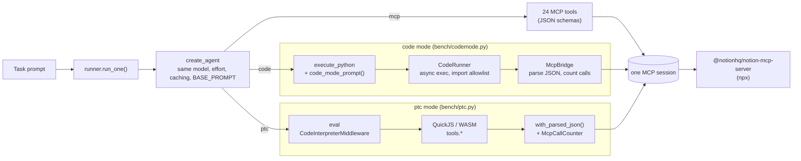
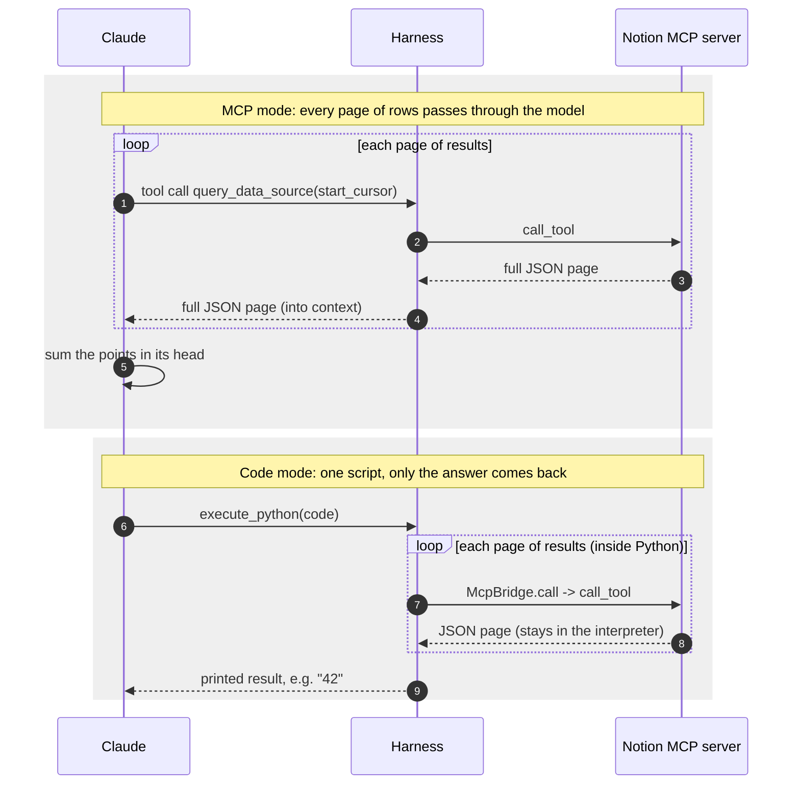
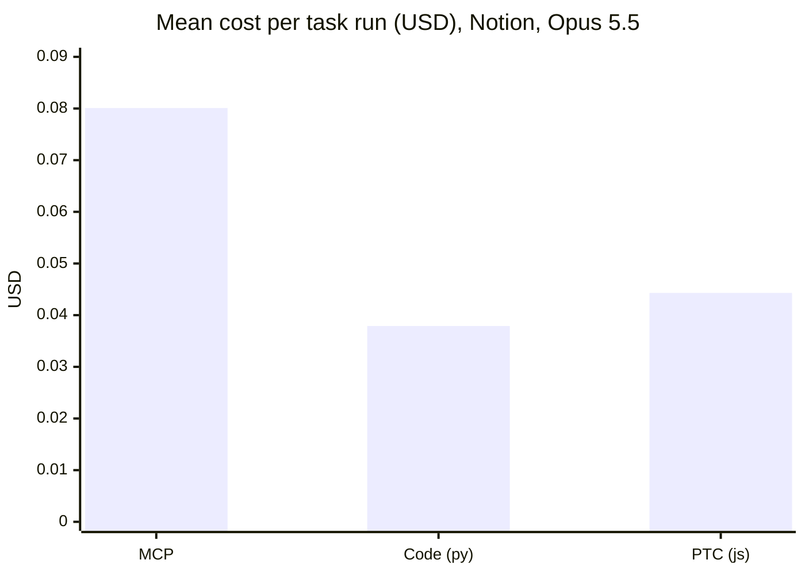
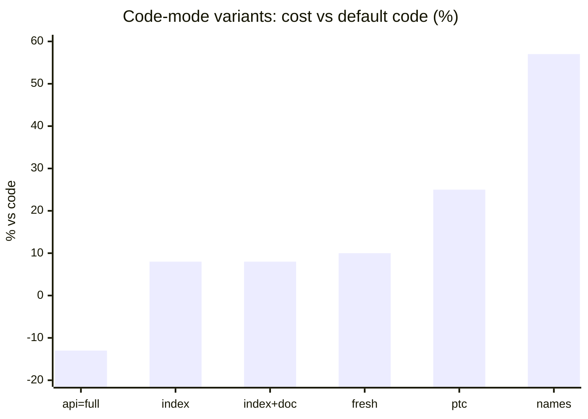
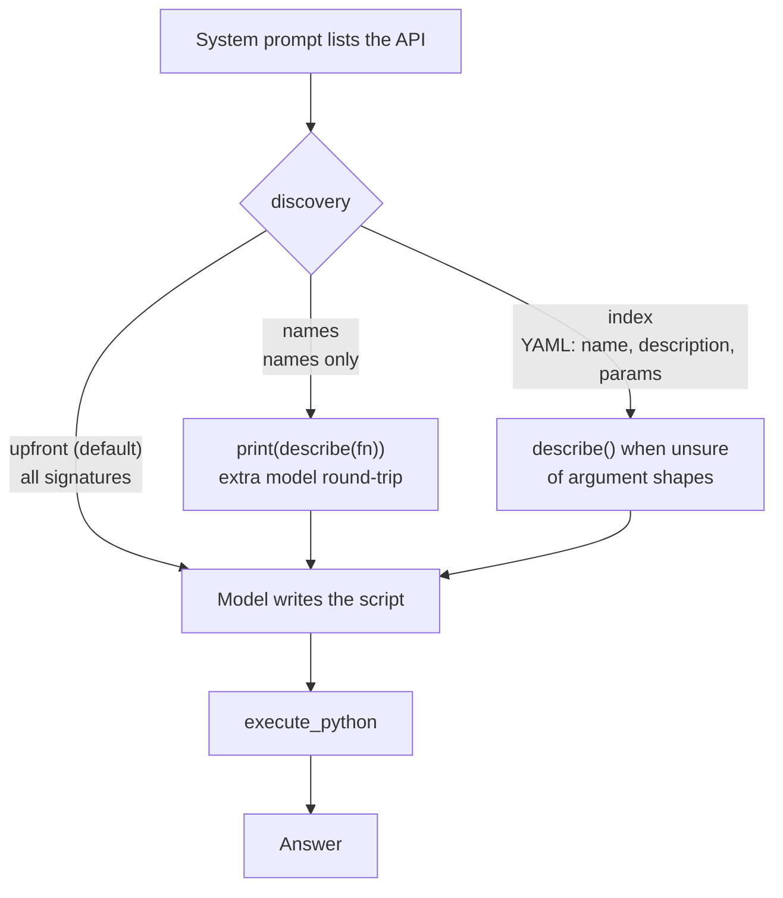

# Findings: MCP vs Code Mode on the Notion MCP server

Date: 2026-11-23. Model `claude-opus-5-5`, effort medium, prompt caching on. Official Notion MCP
server (24 tools). 6 tasks (lookup, aggregate, filter_list, overdue, write, update), 3 runs per
task and mode. Every mode ran on the same LangGraph `create_agent`, base prompt and MCP session.

Data: [`results/report.md`](../results/report.md) (MCP vs code vs ptc, 54 runs) and
[`results/ablation_report.md`](../results/ablation_report.md) (code-mode variants, 126 runs).
What each mode's model saw on its first call is in [`results/prompts/`](../results/prompts/).
Every run in both reports passed its deterministic check.

## How the modes work

All three modes share one harness. Only what the model is given to reach Notion changes.



### What "code mode" means here (the default)

Unless a variant is named, **code mode** means this setup. Section 1 compares it with MCP and
`ptc`. Section 2 changes one setting at a time and reports each variant against it.

| Setting | Default (`code`) | Ablation variants (section 2) |
|---|---|---|
| API listing (`api`) | `compact`: one-line Python stub per function, top-level parameter types, one-line description | `full`: nested parameter types plus each parameter's description |
| Discovery (`discovery`) | `upfront`: all 24 functions listed in the system prompt | `names`: names only; `index`: skills-style YAML (name, description, parameter names). Details come from `describe()` |
| `describe("fn")` returns | `json`: the raw MCP input schema | `doc`: a readable signature with each parameter's description |
| Interpreter state (`state`) | `persist`: variables persist between `execute_python` calls in a run | `fresh`: wiped before every call |
| Tool results | parsed from JSON into Python dicts and lists before the code sees them | (not varied) |

On the command line, `--modes code` runs this default; a variant is written as
`code:api=full` or `code:discovery=index,describe=doc`.

The core difference, on a task that has to page through a database and add up a column:



In MCP mode every page of raw JSON goes through the model's context. In code mode the model
writes one script; the pages stay in the Python process and only the printed answer returns.

### Code samples

The model gets one tool. A script it might write for the "sum Diego's in-progress points" task
(this one is the scripted test in `tests/test_pipeline.py`; live runs look similar):

```python
rows, cur = [], None
while True:
    r = await notion.query_data_source(data_source_id=ds_id, start_cursor=cur)
    rows += r["results"]
    if not r["has_more"]:
        break
    cur = r["next_cursor"]
sum(x["properties"]["Points"]["number"] for x in rows
    if x["properties"]["Owner"]["select"]["name"] == "Diego"
    and x["properties"]["Status"]["select"]["name"] == "In progress")
```

The harness side is small. `McpBridge` turns each `notion.<fn>()` into an MCP call and parses
the result (`bench/codemode.py`, simplified):

```python
async def call(self, py: str, **kwargs) -> Any:
    tool = self.by_py_name[py]
    args = {k: v for k, v in kwargs.items() if v is not None}
    self.calls += 1
    res = await self.session.call_tool(tool.name, args)
    out = res.structuredContent or json.loads(text_of(res.content))
    if res.isError:
        raise RuntimeError(f"{tool.name} failed: {str(out)[:2000]}")
    return out
```

`CodeRunner` wraps the model's code in an `async def` so top-level `await` works, prints the
last bare expression like a notebook cell, and keeps variables between calls.

`ptc` mode is LangChain's middleware with the same limits, plus our two fixes
(`bench/ptc.py`):

```python
CodeInterpreterMiddleware(
    ptc=[_with_ts_safe_schema(with_parsed_json(t)) for t in mcp_tools],
    timeout=120.0, max_result_chars=20_000, mode="turn", subagents=False,
)
```

What the model reads for the same Notion function, per mode (from `results/prompts/`):

```python
# code (compact, default)
async def notion.query_data_source(data_source_id: str, filter_properties: list = None,
    filter: dict | str = None, sorts: list = None, start_cursor: str = None, ...) -> Any
    """Notion | Query a data source"""
```

```python
# code:api=full (nested types + Args)
async def notion.query_data_source(data_source_id: str, filter_properties: list[str | dict] = None,
    filter: dict | str = None,
    sorts: list[{"property": str, "direction": Literal['ascending', 'descending']} | str | dict] = None, ...) -> Any
    """Notion | Query a data source ...
    Args:
        data_source_id: Identifier for a Notion data source (database)
        filter_properties: A list of page property value IDs to limit the response"""
```

```yaml
# code:discovery=index (skills-style frontmatter)
- name: notion.query_data_source
  description: "Notion | Query a data source"
  required: [data_source_id]
  optional: [filter_properties, filter, sorts, start_cursor, page_size, archived, in_trash]
```

```ts
// ptc (TypeScript, rendered by langchain-quickjs)
/** Notion | Query a data source */
tools.APIQueryDataSource(input: {
  /** Identifier for a Notion data source (database) */ data_source_id: string;
  sorts?: ({ property: string; direction: "ascending" | "descending" } | string | Record<string, unknown>)[];
  start_cursor?: string; page_size?: number; ...
}): Promise<unknown>
```

In MCP mode the model gets this function as a JSON Schema tool definition instead; all 24
definitions make up most of MCP mode's 8,942-token first call.

## 1. Code mode beats classic MCP tool calling



| | MCP | Code (Python) | PTC (LangChain, JS) |
|---|---:|---:|---:|
| Cost per run | $0.0801 | $0.0379 (**-53%**) | $0.0443 (-45%) |
| Total tokens per run | 57,150 | 19,163 (-66%) | 27,590 (-52%) |
| First-call input (tokens) | 8,942 | 2,132 | 5,474 |
| Wall time (s) | 7.7 | 9.8 | 10.9 |
| Success | 100% | 100% | 100% |
| Cost Δ vs MCP, 95% CI | | -62% to -28% | -57% to -17% |
| Tasks cheaper than MCP | | 5 of 6 | 4 of 6 |

95% CIs come from a stratified bootstrap over the existing runs (`uv run bench-stats`, full
tables in [`results/stats.md`](../results/stats.md)). Both code modes are clearly cheaper than
MCP and clearly slower.

- **The saving comes from two places.** The prompt is smaller (one code tool and an API listing,
  instead of 24 JSON schemas), and raw API responses stay in the interpreter instead of going
  into the model's context.
- **The bigger the task, the bigger the win.** On `write` (several API calls), MCP used 156k
  tokens and $0.25 per run. Code mode used 24k tokens and $0.05 (-80%).
- **That one task carries a lot of the average.** Leave `write` out and code mode is about 23%
  cheaper than MCP, not 53%, and the median run is 21% cheaper ($0.033 vs $0.043). Code mode
  cost *more* than MCP on `aggregate` ($0.049 vs $0.032 per run). Tokens are the steadier signal: code mode used fewer on all 6 tasks.
- **Code mode is slower** (+27% wall time for Python, +42% for PTC). It makes fewer model
  calls, but each one writes code that then has to run. Here it trades seconds for dollars.

## 2. What matters inside code mode (ablations)



Each `code:` variant changes one setting of default code mode (`ptc` is shown for reference; see [What "code mode" means
here](#what-code-mode-means-here-the-default)). **Cost Δ is against default code mode, not MCP**;
every variant still cost less than MCP mode.

| Variant | Cost Δ vs default code | First-call input | Tool output into context | Verdict |
|---|---:|---:|---:|---|
| `api=full`: nested types plus per-parameter docs | **-13%** (CI -28% to +3%) | 4,448 (+109%) | 3,216 (-49%) | Lowest mean, cheaper on 4 of 6 tasks (all the multi-call ones). Likely better, not proven |
| `discovery=index`: skills-style YAML frontmatter | +8% (CI -4% to +22%) | 2,007 | 8,087 | No gain |
| `discovery=index,describe=doc`: plus a readable `describe()` | +8% (CI -6% to +25%) | 2,016 | 8,503 | No gain |
| `state=fresh`: variables wiped between calls (Cloudflare's model) | +10% (CI -4% to +25%) | 2,145 | 8,428 | Tie; leans toward keeping state |
| `ptc`: LangChain `langchain-quickjs` | **+25%** (CI +3% to +49%) | 5,474 | 5,582 | Costs more than our Python |
| `discovery=names`: names only, details through `describe()` | **+57%** (CI +29% to +88%) | 1,327 | 19,727 (+213%) | Worst, clearly |

How the discovery variants differ:



`names` and `index` save prompt tokens but push the model into `describe()` lookups, and each
lookup costs a model round-trip plus the schema text.

- **Give the model the full API up front.** `api=full` doubles the prompt, but with caching
  that costs little, and the model printed half as much tool output. It had the lowest mean
  cost, but its CI (-28% to +3%) just crosses zero, so treat it as a likely gain, not a proven
  one. It never cost clearly more.
- **Lazy discovery (Cloudflare's current design, skills-style progressive disclosure) did not
  help at this size.** Names-only discovery was clearly worse (+57%); the skills-style index was a
  tie (+8%, CI crosses zero). Each `describe()` round adds a model call and brings schema text into context.
  With 24 tools, loading everything up front is cheaper. Lazy discovery likely only pays off
  with hundreds of tools, which this benchmark did not test.
- **The format of the listing matters little.** YAML frontmatter and Python stubs came out
  within noise of each other (index entries were generated from the schemas, not hand-written).
- **Python vs JS:** `code:api=full` shows about as much API detail as PTC's TypeScript
  signatures, and it cost about 30% less. So PTC's higher cost is not just its larger prompt.
  It may come from JS/QuickJS or from the middleware's own prompt text; this benchmark did not
  separate the two.
- **Keeping state between calls** may help a little (`fresh` +10%, a tie statistically); the
  fresh runs re-fetched more (17% more MCP calls).

## 3. Integration lessons

- **MCP tools inside LangChain's PTC return raw content blocks** (`[{type: "text", text:
  "<json>"}]`), while its prompt tells the model that results need no `JSON.parse`. We parse the
  JSON for the model (`--ptc-parse-json`, on by default) so the comparison measures the design,
  not this integration gap.
- **langchain-quickjs 0.4.0 crashes on list-valued JSON Schema `type`**, which the Notion server
  uses. Worked around with `ts_safe_schema` in `bench/ptc.py`.
- **The Notion server's schemas repeat a shared `$defs` block in every tool**, so one raw
  `describe()` is roughly 1,500 tokens (estimated from characters). Rendering it as a signature cuts that to 130 to 220.
- **PTC's inner MCP calls can be traced:** the bridge passes the run's callbacks into each tool
  call, so they show up in LangSmith and can be counted.

## Caveats

- 3 runs per task and mode. The 95% CIs in [`results/stats.md`](../results/stats.md) separate
  what is clear (code vs MCP cost and tokens, `names` and `ptc` costing more) from ties
  (`index`, `fresh`) and leans (`api=full`).
- The headline -53% leans on the `write` task; without it the gap is about -23%.
- One server (Notion, 24 tools), one model, and small tasks. Phase 3 (large paginated reads,
  joins, bulk updates) was not run. Code mode should gain most there.
- The `@notionhq/notion-mcp-server` version was not pinned in the runs; the npx cache shows
  2.6.1 installed the day of the runs, and `bench/servers.py` now pins 2.6.1. The ablation's `update` task was
  re-run in a second session after the first ran out of API credit; the report combines both.
- Code mode's `exec` is not a security sandbox. Any real use needs an isolated runtime.

## Recommendation

For an agent calling an MCP server with tens of tools: use code mode when the tasks move a
lot of data, and expect it to be a bit slower. List the whole API up front (the detailed listing
is the best bet), keep interpreter state for the whole run, and parse tool results into native
values before the code sees them. Do not hide the API behind name-only lookups.

For a design that applies these findings to several agents sharing one full API listing, see
[MULTI_AGENT.md](MULTI_AGENT.md) (not built or measured).
