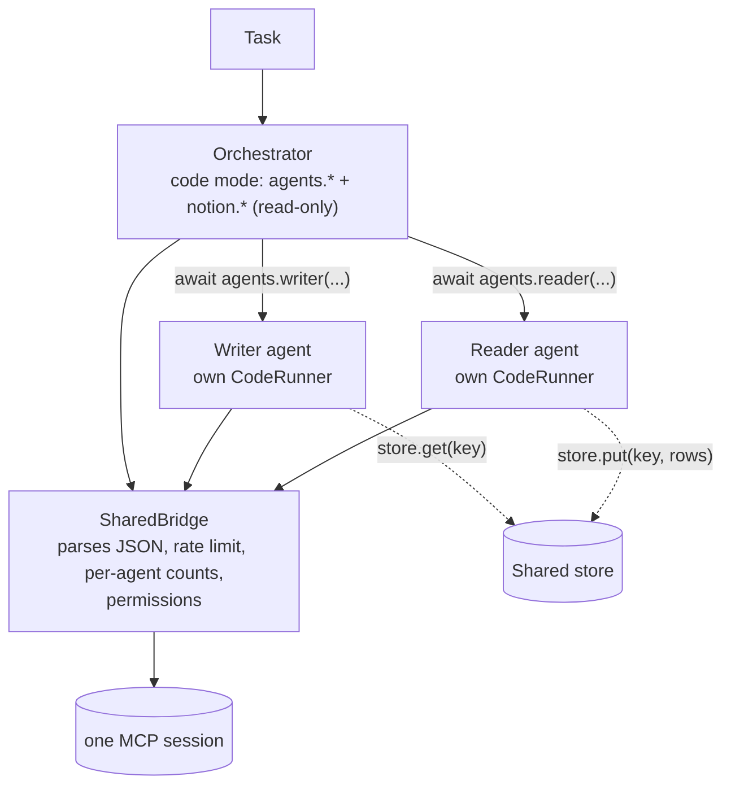
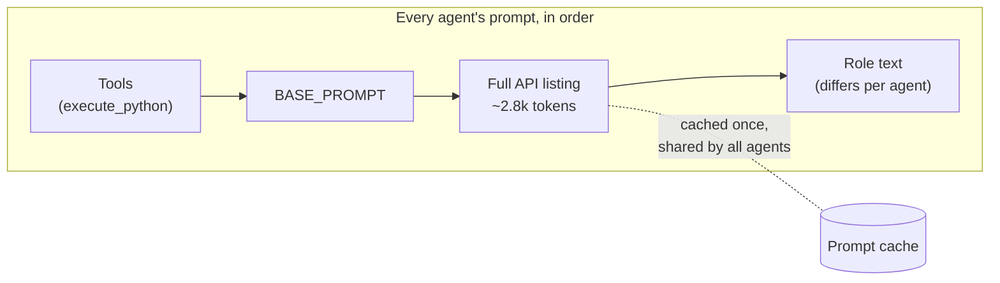

# Multi-agent design with a full-API code mode

Status: **design only, not built or measured.** It applies the single-agent results in
[FINDINGS.md](FINDINGS.md) to a system with several agents. Everything here is an
extrapolation until a benchmark tests it.

## What carries over from the findings

| Finding (single agent) | Rule for multiple agents |
|---|---|
| A full API listing (`api=full`) beat lazy lookup (`names`, `index`) | Every agent that calls the API gets the full listing in its prompt. No names-only listings. |
| The bigger prompt was cheap because it was cached | Every agent gets the **same** listing, in the same order, so they share prompt-cache hits. |
| Raw API data stays out of the model's context | Agents hand each other IDs and short summaries, never raw API responses. |
| Keeping variables between calls helped (`state=fresh` cost +10%) | Each agent keeps its own interpreter for its whole run. Agents don't share variables. |
| Parsing tool results into native values was needed | One shared bridge parses MCP results for every agent. |

## Architecture



### 1. One shared prompt prefix

Anthropic's prompt cache matches on the start of the prompt. If every agent's prompt starts with
the same base prompt and the same full listing, the listing is billed at the cache-read rate
(about 10% of the input price) after the first call, whichever agent made it.



- Put role-specific text **last**. Anything that differs before the listing breaks the shared
  cache.
- Keep the tool definition identical too (`execute_python` with the same description).
- The cache expires after 5 minutes without use (or 1 hour with the longer TTL), so a burst of
  agents benefits most.

### 2. Permissions in the bridge, not the prompt

Scoping each agent's listing to its own functions would shrink prompts, but every agent would
then have a different prefix and lose the shared cache. Instead, every agent sees the full
listing, and its view of the bridge refuses calls it isn't allowed to make:

```python
class SharedBridge(McpBridge):
    """One MCP session for all agents: parse JSON, rate limit, count per agent, enforce access."""

    def __init__(self, session, tools, rps: float = 3.0):
        super().__init__(session, tools)
        self._limit = AsyncLimiter(rps, 1)          # e.g. aiolimiter; Notion allows ~3 req/s
        self.by_agent: Counter[str] = Counter()

    def view(self, agent: str, allow: set[str] | None) -> "BridgeView":
        return BridgeView(self, agent, allow)


class BridgeView:
    def __init__(self, bridge: SharedBridge, agent: str, allow: set[str] | None):
        self.bridge, self.agent, self.allow = bridge, agent, allow
        self.by_py_name = bridge.by_py_name           # same listing for everyone

    async def call(self, py: str, **kwargs):
        if self.allow is not None and py not in self.allow:
            raise PermissionError(f"{self.agent} may not call {py}")  # model sees it, adapts
        async with self.bridge._limit:
            self.bridge.by_agent[self.agent] += 1
            return await self.bridge.call(py, **kwargs)
```

### 3. Agents as functions in the orchestrator's code

The orchestrator is a code-mode agent too. Each subagent is an async function in its namespace,
so it can run several agents in parallel and combine their results in code, without one model
tool call per agent:

```python
# what the orchestrator's model writes
a, b = await asyncio.gather(
    agents.reader("Diego's in-progress tasks. Return page ids only."),
    agents.reader("Overdue tasks. Return page ids only."),
)
both = set(a.split()) & set(b.split())
await agents.writer(f"Set Status to Done on pages: {sorted(both)}")
```

LangChain's `langchain-quickjs` has the same idea built in (its `task()` global, which the
benchmark turned off with `subagents=False`).

### 4. Large data goes through a store

A subagent that gathers a lot of data writes it to a shared store and returns a short handle.
The next agent reads it from its own code. Raw rows never enter any model's context:

```python
# reader agent's code
rows = await fetch_all(notion.query_data_source, data_source_id=ds)
store.put("open_tasks", rows)
print(f"open_tasks: {len(rows)} rows")        # this line is all the orchestrator sees
```

```python
# writer agent's code
for page in store.get("open_tasks"):
    await notion.patch_page(page_id=page["id"], properties={"Status": {"select": {"name": "Done"}}})
```

## Wiring it with this repo's code

```python
bridge = SharedBridge(session, raw_tools, rps=3)
LISTING = code_mode_prompt("notion", "Notion", raw_tools, api="full")   # rendered once, shared
store = Store()                                                          # dict with put/get

def make_agent(role: str, allow: set[str] | None):
    runner = CodeRunner(bridge.view(role, allow), "notion")             # own state per agent
    runner.globals["store"] = store
    system = BASE_PROMPT.format(label="Notion") + "\n\n" + LISTING + f"\n\nRole: {ROLES[role]}"
    agent = create_agent(make_model(MODEL, EFFORT), [build_code_tool(runner)], system_prompt=system,
                         middleware=[AnthropicPromptCachingMiddleware(ttl="5m")])
    return agent, runner

READ_ONLY = {n for n in bridge.by_py_name if n.startswith(("get_", "retrieve_", "query_", "post_search"))}
workers = {"reader": make_agent("reader", READ_ONLY)[0], "writer": make_agent("writer", None)[0]}
orchestrator, orch_runner = make_agent("orchestrator", READ_ONLY)
orch_runner.globals["agents"] = AgentNamespace(workers)  # async fn per agent -> final text
```

Reused as they are: `CodeRunner`, `build_code_tool`, `code_mode_prompt(api="full")`,
`make_model`, the caching middleware and `McpCallCounter` (callbacks already follow nested
calls). New: `SharedBridge` and `BridgeView`, `AgentNamespace` (runs an agent and returns its
final message text), and `Store`. `CodeRunner` would need to accept a bridge view; it only uses
`call`, `describe` and `by_py_name`.

## Risks

- **Cache order.** Role text, timestamps or per-agent tool lists placed before the listing break
  cache sharing silently. Check `cache_read_tokens` per agent.
- **Parallel writes.** Two writers can update the same page. Give one agent ownership of a page
  set, or make writes safe to repeat.
- **More model-written code running.** `exec` here is not a security sandbox. Run each agent's
  interpreter in isolation (container or V8 isolate) and keep write access to the fewest agents.
- **Rate limits.** Parallel agents hit the server's limit quickly. The shared limiter queues
  calls instead of failing them.
- **Cost of coordination.** Each subagent adds at least two model calls. On tasks as small as this
  benchmark's, one code-mode agent that loops in a script is likely cheaper.

## How to test it

Compare against a single `code:api=full` agent on the same tasks, with the same harness rules as
the benchmark (same model, effort, caching, MCP session):

- Tasks that suit multiple agents: Phase 3's bulk read, join across two data sources, and bulk
  update, plus a task spanning two MCP servers.
- Metrics: cost, tokens and wall time in total and per agent, cache-read share per agent, MCP
  calls, success. Parallel agents should win on wall time first, if anywhere.
